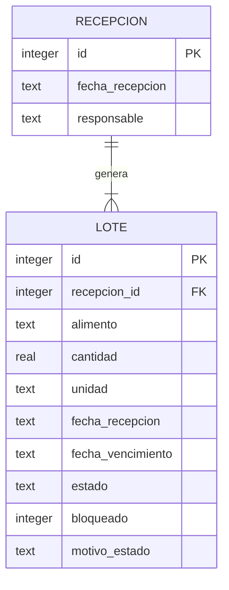

# Design Document — Control de Inventario por Lotes y Priorización FEFO

## 1. Overview

Este documento describe el diseño técnico del módulo de control de inventario por lotes del prototipo web Banco de Alimentos Comunitario.

Su propósito es establecer cómo se implementarán las funcionalidades definidas en `requirements.md`, tomando como punto de partida la aplicación existente desarrollada con Ruby, Sinatra y SQLite.

El sistema está orientado a voluntarios con distintos niveles de experiencia digital. Por ello, prioriza una interfaz sencilla, accesible y adaptable a teléfonos y computadores, además de una arquitectura de bajo costo y fácil mantenimiento.

### Responsabilidades del módulo

- Registrar recepciones que pueden contener distintos tipos de alimentos.
- Generar un lote independiente por cada tipo de alimento registrado.
- Identificar cada lote mediante sus datos y un identificador único.
- Mantener los lotes pendientes de revisión hasta verificar su condición.
- Incorporar al stock disponible únicamente alimentos revisados y aptos.
- Consultar el inventario agrupado por tipo de alimento.
- Ordenar los lotes disponibles según el criterio FEFO.
- Mostrar alertas visuales de vencimiento próximo.
- Identificar y excluir los alimentos vencidos del stock disponible.

### Estado de la implementación inicial

La aplicación ya cuenta con un formulario de registro de alimentos, almacenamiento de lotes en SQLite y una pantalla de consulta con ordenamiento por fecha de vencimiento.

El diseño contempla ampliar estas funcionalidades sin reemplazar innecesariamente la estructura existente.

---

## 2. Architecture

### 2.1. Stack tecnológico

| Capa | Tecnología | Uso |
|---|---|---|
| Lenguaje | Ruby | Lógica de negocio y validaciones |
| Framework web | Sinatra | Rutas y procesamiento de solicitudes |
| Interfaz | HTML, CSS y JavaScript | Formularios y visualización |
| Plantillas | ERB | Generación de páginas dinámicas |
| Base de datos | SQLite | Almacenamiento de recepciones y lotes |
| Contenedores | Docker | Entorno de ejecución |
| Control de versiones | GitHub | Gestión del código fuente |

No se incorporarán tecnologías adicionales sin una necesidad justificada.

### 2.2. Arquitectura por capas

**Interfaz de usuario**

Presenta los formularios de recepción, consulta del inventario, estados de los lotes y alertas de vencimiento.

**Aplicación Ruby + Sinatra**

Gestiona las rutas, recibe los datos de los formularios, valida la información y aplica las reglas de negocio.

**Base de datos SQLite**

Almacena las recepciones y sus lotes asociados. La información debe conservarse entre reinicios del contenedor mediante un volumen persistente de Docker.

### 2.3. Flujo general

1. El voluntario ingresa los datos de una recepción.
2. El servidor valida los datos recibidos.
3. Se registra la recepción y se genera un lote independiente por cada alimento.
4. Los lotes quedan pendientes de revisión.
5. Después de su revisión, los alimentos aptos pasan a estar disponibles.
6. El inventario se consulta agrupado por alimento y ordenado según FEFO.
7. El servidor verifica las fechas de vencimiento antes de mostrar el inventario.

---

## 3. Components and Interfaces

### 3.1. Pantallas principales

| Pantalla o componente | Propósito | Estado |
|---|---|---|
| Inventario de alimentos | Consultar lotes registrados y cantidades por alimento | Existe; requiere ampliaciones |
| Registro de recepción | Registrar una donación con uno o varios alimentos | Existe formulario; requiere soporte multi-alimento |
| Revisión de lotes | Revisar la condición y disponibilidad de los alimentos | Por implementar |
| Alertas de vencimiento | Identificar alimentos próximos a vencer o vencidos | Por implementar |

No se incorporarán en esta etapa pantallas de entregas, devoluciones, mermas, reversas, administración avanzada de usuarios ni historial de movimientos.

### 3.2. Registro de recepción

El formulario permitirá registrar una recepción que contenga uno o varios tipos de alimentos.

Cada alimento tendrá sus propios campos:

- Tipo o nombre del alimento.
- Cantidad.
- Unidad de medida.
- Fecha de vencimiento, cuando corresponda.

Los datos generales de la recepción incluirán:

- Fecha de recepción.
- Persona responsable.

El usuario podrá agregar más de un alimento antes de confirmar el registro.

Al guardar, el sistema generará una recepción y un lote independiente por cada alimento ingresado.

### 3.3. Consulta del inventario

El inventario se organizará agrupando los lotes por tipo de alimento.

Para cada alimento se mostrará:

- Nombre del alimento.
- Cantidad disponible y unidad de medida.
- Cantidad pendiente de revisión.
- Detalle de sus lotes.
- Fecha de recepción.
- Fecha de vencimiento, cuando corresponda.
- Estado del lote.

Los lotes disponibles se ordenarán según FEFO. Los demás estados se mostrarán diferenciados y no participarán en la priorización.

### 3.4. Revisión de alimentos

Cada lote nuevo tendrá el estado inicial `Pendiente_de_revision`.

El voluntario podrá revisar la condición del alimento y registrar el resultado:

- `Disponible`: cuando el alimento haya sido revisado y sea apto.
- `No_apto`: cuando se determine que no puede incorporarse al inventario disponible.

La interfaz debe impedir que los lotes pendientes o no aptos se contabilicen como stock disponible.

### 3.5. Identidad visual y accesibilidad

La aplicación utiliza una identidad visual basada en tonos turquesa y naranja, complementados con tonos verdes suaves para diferenciar los estados del inventario.

**Paleta principal:**
- Turquesa principal: `#5DC1B9`.
- Turquesa claro: `#8AE0DB`.
- Turquesa suave: `#B8F0ED`.
- Naranja principal: `#FF9800`.
- Naranja claro: `#FFC340`.
- Fondo: `#F7F8F5`.
- Texto: `#29434A`.
- Blanco: `#FFFFFF`.

**Degradé institucional:**
`linear-gradient(110deg, #5DC1B9 0%, #8AE0DB 45%, #FF9800 100%)`

**Criterios de aplicación visual:**
- Las tarjetas de resumen utilizan colores suaves diferenciados: turquesa claro para lotes registrados, verde suave para pendientes de revisión y naranja suave para próximos a vencer.
- Los encabezados de las tablas de stock utilizan turquesa principal.
- En el detalle de lotes, el nombre del alimento utiliza turquesa principal y los encabezados de la tabla, turquesa claro.
- Los botones y elementos de interacción mantienen contraste y coherencia con la paleta.
- Los colores de los estados permiten distinguir visualmente los alimentos disponibles, pendientes de revisión, no aptos y vencidos.
- Las alertas preventivas y prioritarias mantienen una jerarquía visual diferenciada.

**Accesibilidad y consistencia:**
- Utilizar lenguaje sencillo y etiquetas comprensibles.
- Mantener contraste suficiente entre textos y fondos.
- No depender exclusivamente del color para comunicar estados o alertas.
- Conservar la adaptación de tablas y componentes a pantallas de distintos tamaños.
- Mantener la identidad visual en las distintas secciones de la aplicación.

---

## 4. Data Models

### 4.1. Entidades principales

Para la primera implementación se utilizarán dos entidades:

**RECEPCION**

Representa el ingreso de una donación al banco de alimentos.

Campos propuestos:

| Campo | Tipo | Descripción |
|---|---|---|
| id | INTEGER | Identificador único |
| fecha_recepcion | TEXT | Fecha de ingreso |
| responsable | TEXT | Persona que registra la recepción |

**LOTE**

Representa una cantidad específica de un único tipo de alimento recibida en una donación.

Campos:

| Campo | Tipo | Descripción |
|---|---|---|
| id | INTEGER | Identificador único del lote |
| recepcion_id | INTEGER | Referencia a la recepción |
| alimento | TEXT | Nombre o tipo de alimento |
| cantidad | REAL | Cantidad registrada |
| unidad | TEXT | Unidad de medida |
| fecha_recepcion | TEXT | Fecha de recepción |
| fecha_vencimiento | TEXT | Fecha de vencimiento, opcional |
| responsable | TEXT | Persona responsable |
| estado | TEXT | Estado actual del lote |
| bloqueado | INTEGER | Indicador de disponibilidad restringida |
| motivo_estado | TEXT | Motivo asociado al cambio de estado, cuando corresponda |

La estructura actual de la tabla `lotes` se conservará y se ampliará para asociar cada lote con una recepción.

### 4.2. Relación entre entidades

Una recepción puede generar uno o varios lotes.

Cada lote corresponde a un solo tipo de alimento y pertenece a una recepción.

### 4.3. Estados de los lotes

| Estado | Descripción | ¿Se considera disponible? |
|---|---|---|
| `Pendiente_de_revision` | Alimento recibido que aún no ha sido revisado | No |
| `Disponible` | Alimento revisado y apto | Sí, si tiene cantidad mayor que cero y no está bloqueado |
| `No_apto` | Alimento que no cumple las condiciones para su utilización | No |
| `Vencido` | Alimento cuya fecha de vencimiento alcanzó o superó la fecha actual | No |

El estado inicial de todos los lotes será `Pendiente_de_revision`.

Los cambios de estado se validarán en el backend.

---

## 5. Key Flows

### 5.1. Registro de una recepción multi-alimento

1. El voluntario abre el formulario de recepción.
2. Ingresa la fecha de recepción y su nombre como responsable.
3. Agrega uno o varios alimentos con sus respectivas cantidades, unidades y fechas de vencimiento.
4. El servidor valida los campos obligatorios, las cantidades y las fechas.
5. El servidor registra la recepción.
6. Por cada alimento ingresado, genera un lote independiente con estado `Pendiente_de_revision`.
7. La operación se realiza dentro de una transacción de SQLite. Si ocurre un error, se revierte el registro completo.
8. El usuario recibe una confirmación del registro.

### 5.2. Revisión de un lote

1. El voluntario consulta los lotes pendientes.
2. Selecciona un lote y revisa la condición del alimento.
3. Registra si el alimento es apto o no apto.
4. El servidor valida el cambio de estado.
5. Si es apto, el lote pasa a `Disponible`.
6. Si no es apto, pasa a `No_apto`.
7. El inventario se actualiza según el nuevo estado.

### 5.3. Consulta del inventario y priorización FEFO

1. El usuario ingresa a la pantalla de inventario.
2. El servidor verifica los vencimientos antes de calcular las cantidades disponibles.
3. Los lotes se agrupan por tipo de alimento.
4. Se calcula el stock disponible considerando únicamente lotes `Disponible`, con cantidad mayor que cero y sin bloqueo.
5. Los lotes disponibles de cada alimento se ordenan por fecha de vencimiento ascendente.
6. Los lotes sin fecha de vencimiento aparecen al final, ordenados por fecha de recepción desde la más antigua.
7. Los lotes pendientes, no aptos y vencidos se muestran por separado.

### 5.4. Alertas y vencimientos

El servidor calculará los días restantes entre la fecha actual y la fecha de vencimiento.

| Condición | Presentación |
|---|---|
| Faltan 14 días o menos | Alerta visual preventiva |
| Faltan 7 días o menos | Alerta visual prioritaria |
| Fecha de vencimiento igual o anterior a hoy | Estado `Vencido` |

Antes de mostrar el inventario o calcular el stock disponible, el backend actualizará los lotes cuya fecha de vencimiento haya alcanzado o superado la fecha actual.

Los lotes vencidos quedarán excluidos del stock disponible.

No se utilizarán servicios externos de programación de tareas en esta primera versión.

---

## 6. Business Rules

1. Cada lote corresponde a un único tipo de alimento.
2. Una recepción puede contener varios tipos de alimentos y generar varios lotes independientes.
3. Cada lote debe tener un identificador único.
4. La cantidad debe ser mayor que cero.
5. La fecha de vencimiento no puede ser anterior a la fecha de recepción.
6. La fecha de vencimiento es opcional cuando no corresponda al alimento.
7. Todos los lotes nuevos comienzan en estado `Pendiente_de_revision`.
8. Solo los lotes aptos y revisados pueden pasar a estado `Disponible`.
9. Los lotes pendientes, no aptos y vencidos no se incluyen en el stock disponible.
10. El stock disponible considera únicamente lotes con cantidad mayor que cero y sin restricciones de utilización.
11. FEFO se aplica entre lotes del mismo tipo de alimento.
12. Los lotes sin fecha de vencimiento se ordenan después de los que tienen vencimiento.
13. Las validaciones críticas se ejecutan en el backend y no dependen exclusivamente de la interfaz.

---

## 7. Error Handling and Validation

El sistema debe validar los datos antes de guardarlos.

Se deben contemplar, al menos, los siguientes casos:

- Nombre del alimento vacío.
- Cantidad igual o inferior a cero.
- Unidad de medida no seleccionada.
- Fecha de recepción vacía o inválida.
- Fecha de vencimiento inválida.
- Fecha de vencimiento anterior a la fecha de recepción.
- Error durante el registro de una recepción con varios alimentos.

Los mensajes de error deben ser claros y orientar al usuario para corregir la información.

Las operaciones de registro multi-alimento deben ser atómicas: no se debe guardar una recepción incompleta cuando alguno de sus lotes presenta un error.

---

## 8. Testing and Verification

La implementación se verificará utilizando datos ficticios.

Se comprobarán los siguientes escenarios:

1. Registrar una donación con arroz, fideos y aceite y verificar que se generen tres lotes independientes asociados a una misma recepción.
2. Verificar que cada lote tenga su tipo de alimento, cantidad, unidad, fechas y estado inicial correcto.
3. Revisar un lote apto y comprobar que se incorpore al stock disponible.
4. Verificar que un lote pendiente o no apto no se incluya en el stock disponible.
5. Registrar varios lotes del mismo alimento con fechas de vencimiento diferentes y comprobar su orden FEFO.
6. Comprobar que los lotes sin fecha de vencimiento aparezcan al final.
7. Verificar las alertas de 14 y 7 días.
8. Comprobar que un lote vencido cambie de estado y quede excluido del stock disponible.
9. Comprobar que los datos permanezcan almacenados después de reiniciar el contenedor Docker.